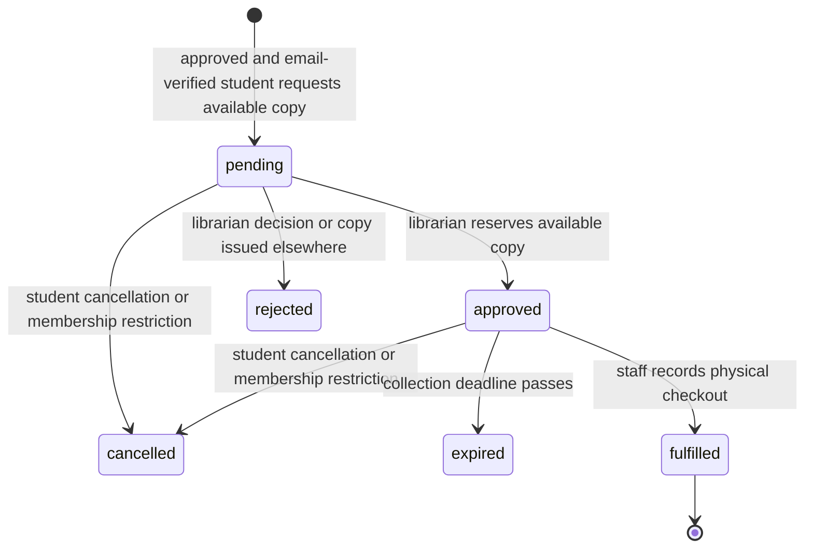

# Architecture

## Responsibilities

The static React/Vite/TypeScript client provides navigation, forms, validation previews and reports. Tailwind and project CSS provide the responsive interface without a UI framework. React Router uses hash routes: `/repository/#/catalogue` needs no server rewrite. Vite's base setting controls every emitted asset URL. Supabase's public client uses the current session token. No privileged secret belongs in the client.

Supabase Auth owns passwords, email confirmation and sessions. The `auth.users` insert trigger creates a pending profile from validated identity metadata. Role/status metadata supplied by a user is ignored. Staff appointments are stored separately. Database role checks read live assignments rather than JWT metadata, so revocation applies on the next operation even if a token is still valid.

PostgreSQL is the source of circulation truth. Every application table has RLS; browser roles have no INSERT, UPDATE or DELETE grants. Mutations use individually granted, guarded security-definer RPCs with fixed empty search paths. Public catalogue access is a projection RPC that never reads student identity tables. Student private read policies require `auth.uid()` ownership; their labelled circulation RPC filters every query by that same ID.

## Circulation state machine

A loan is a separate record, created only at physical checkout. Active loans have no return timestamp. Check-in sets both the return timestamp and receiving staff ID. Copy availability is **derived**, not a mutable flag: active inventory, good/worn condition, no active loan, and no unexpired approved reservation. Thus a failed client refresh cannot create contradictory availability flags. Returned damaged or withdrawn copies stay unavailable.

## Transaction strategy

Every mutating RPC takes the same transaction-scoped advisory lock. This deliberately serializes departmental mutations, including membership, settings, import and staff changes, keeping limit calculations and reservation transitions consistent across competing operators. Transactions are short; no lock spans a user's confirmation screen. This conservative choice favours correctness and simple maintenance over high throughput. A future larger deployment can replace the shared lock with an audited per-borrower/per-copy locking order.

Partial unique indexes additionally enforce one active loan per copy, one reservation per copy, and one active student/copy request. Checkout validates borrower approval and verified email, inventory condition, reservation owner/deadline and borrowing limits, then inserts the loan and fulfils/rejects outstanding requests atomically. Reservations count toward borrowing limits to prevent overbooking. Failed operations roll back all changes and their audit rows.

Expired reservations cease blocking availability immediately. Successful circulation transactions persist expired status through lazy cleanup. The UI displays elapsed reservations as expired even before cleanup. Failed checkout attempts do not persist cleanup because their transaction rolls back; timestamp-based availability remains correct.

## Access matrix

| Operation / record                                 | Visitor | Student                                 | Librarian                  | Administrator              |
| -------------------------------------------------- | ------- | --------------------------------------- | -------------------------- | -------------------------- |
| Approved public catalogue fields                   | Read    | Read                                    | Read                       | Read                       |
| Profile, requests, loans                           | No      | Own only                                | Operational read           | Operational read           |
| Request/cancel                                     | No      | Own, approval enforced for new requests | Via own student privileges | Via own student privileges |
| Membership review                                  | No      | No                                      | Yes, except self-review    | Yes, except self-review    |
| Request decision / checkout / check-in / due dates | No      | No                                      | Yes                        | Yes                        |
| Catalogue/copies/import/reports                    | No      | No                                      | Yes                        | Yes                        |
| Staff role read                                    | No      | Own assignment                          | Own assignment             | All                        |
| Appoint/revoke staff and edit policy               | No      | No                                      | No                         | Yes                        |
| Audit history                                      | No      | No                                      | No                         | Yes                        |

## Interfaces and structure

`components/public.tsx` implements home, catalogue, details and Auth forms. `student.tsx` implements own records. `staff.tsx` implements circulation, inventory, import and reports. `admin.tsx` implements privileged controls. Shared Auth/query/CSV helpers live in `lib`; shared feedback and confirmation components live in `components/ui.tsx`.

CSV parsing is client-side with Papa Parse; PostgreSQL revalidates and commits an entire batch. Imports without a book UUID group only fully matching bibliographic metadata, never an assumed ISBN identity. Existing accession conflicts abort the batch. Imports with an explicit book UUID require matching metadata. History is preserved by withdrawal instead of delete, and accession strings cannot be edited after creation.

## External behaviour and cost

Only Supabase Auth/PostgREST and static GitHub Pages are required. No subscriptions or paid integrations were introduced. Confirm current service quotas and billing settings with the department before launch. Catalogue data refreshes on search and after mutations; workspace screens include an explicit refresh control. There is no realtime subscription, automatic reservation mail, or automatic backup service in the application.
